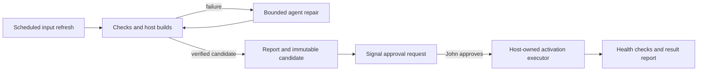

# Agent-assisted NixOS updates

Design recorded on 23 October 2026; implementation task `nixos-6d6`.
No update timer, Signal account, or privileged executor has been enabled by this
design. The recent migration remains tracked separately in `nixos-uez`.

## Confirmed policy

- Automatically prepare updates, build, debug failures, and produce reports.
- Require John's approval before activation on both desktop and NUC.
- Deliver reports and approval requests through Signal.
- Preserve switch inhibitors and request a separate planned reboot when needed.

The Signal identity is still undecided. A dedicated bot account is recommended;
John asked for practical account guidance before choosing it. A dedicated
account is a separate Signal identity, not another linked device on John's
personal account. One central bot can cover multiple hosts and future services.
Linking a personal account and using Note to Self is a viable alternative, with
the different credential scope that linking that account entails.

## Why the built-in update timer is insufficient here

NixOS provides `system.autoUpgrade`, with `switch` and `boot` operations.
The installed nixos-rebuild-ng explicitly warns that `--upgrade` has no effect
for flake-based systems. Refreshing and rebuilding an unchanged lock file does
not advance the pinned package snapshots.

Use a scheduled preparation job that explicitly updates selected flake inputs
in an isolated checkout. Track separately pinned OCI images, Stremio source
versions and hashes, and temporary security fixes too. A timer that only runs
the existing rebuild command would miss those updates.

At design time local main is 25 commits ahead of origin/main. Before enabling
an updater that consumes GitHub, reconcile the published source with the
reviewed local configuration. Candidate reports must identify their exact base
commit. The preparation job must not change John's normal working checkout.

## Proposed workflow

The repair loop has a finite attempt limit and a time/cost limit; values remain
to be configured. Exhausting a limit produces a failure report and a Beads
handoff. No further repair or activation is implied by an expired job.

Start with systemd scheduling, Nix's own update/build commands, a Codex worker,
and small reporting and approval components. Existing OpenRig experiments may
provide execution oversight, but a new orchestration framework is not required.
The worker's execution host and schedule remain deployment choices. Full flake
checks belong on the desktop/build host: evaluating the other hosts on the NUC
previously caused it to realize unrelated workstation dependencies.

### Preparation and debugging

1. Create a clean candidate branch/worktree from the recorded base commit.
2. Refresh the selected inputs and report versions, revisions and image digests.
3. Format, evaluate, check, and build the desktop and NUC candidates. Keep source
   and lock file unchanged between the final successful checks and approval.
4. On failure, give the unprivileged agent the logs, candidate diff and relevant
   module context. Allow edits only in the candidate workspace, then rerun the
   same checks. The coordinator independently records exit codes and artifacts.
5. Produce a report whether the outcome is ready, failed, inconclusive, or needs
   an operator. Build success alone is not an activation or application test.

Codex supports non-interactive execution, workspace permissions, JSONL events
and schema-constrained final reports. The installed CLI exposes these features.
Use an explicit automation profile and keep its authentication out of candidate
build/test environments. No model, authentication method or spending limit has
been selected for the new worker.

The worker must not weaken TLS, remove tests to obtain a pass, change trust or
privilege policy, or bypass switch inhibitors. Today's D-Bus failure should
produce a boot-and-reboot plan. Today's Beads failure should produce a tested
schema-migration fix and a coordinated client/server activation plan. A changed
candidate always requires a new approval.

### Report contents

- Host, base/candidate commit, lock digest and immutable system output path.
- Input/package changes, agent edits, attempts and resource usage.
- Checks actually run, their exit statuses and failures or untested behavior.
- Expected service restarts, schema changes, backup requirements and reboots.
- Proposed privileged actions and the relevant recovery limitations.
- An approval identifier with expiration, plus links or attached durable logs.

Reports must distinguish certificate rejection from timeout or DNS failure.
Unavailable external test endpoints yield an inconclusive result. Container
tests and application workflow checks remain distinct from host package builds.
Reports sent outside the host must exclude credentials and private log content.

## Privileged activation

A small executor owned by the target host performs the approved operation.
Approval binds the host, candidate commit/lock, immutable store path, action,
expiry and a single-use nonce. It must not authorize a mutable branch name or
an arbitrary command supplied through chat. The exact approval protocol needs
implementation and adversarial tests before root activation is enabled.

The executor validates the approval and candidate again at application time,
checks backup results, and invokes the approved prebuilt system. Avoid evaluating
agent-controlled source as root. The agent does not receive a sudo password or
general passwordless sudo. Signal credentials and approval state are outside
the candidate workspace. Beads tracks project outcomes, not the authority to
execute a privileged deployment.

After activation, perform local service checks and a separate client check of
router connectivity. Connectivity rollback support from an existing tool such
as deploy-rs is worth evaluating. A generation rollback does not undo database
migrations: retain verified PostgreSQL, Dolt and application backups and report
when recovery needs an operator. Candidate Beads binaries must not contact the
live database during preparation; shared schema/client changes need a fleet
plan and a backup before the first new client connection.

An activation failure starts a new diagnostic/repair job. Further privileged
changes require a fresh approval. Reboot remains its own approved operation.

## Signal transport and account choice

Signal automation commonly uses signal-cli, an unofficial client supporting
registration, device linking and a JSON-RPC daemon. Keep its interface local
and its cryptographic state private. Its upstream warns that old clients can
stop working as Signal's server protocol changes; the transport needs update
monitoring and a local/manual fallback when notifications are unavailable.

A dedicated bot would appear as a normal contact, such as "Homelab Updates",
and report for both hosts. Registering a fresh numbered account normally needs
a second number under John's control that can receive SMS or voice verification.
Do not register over John's current personal Signal identity. The bot can be
registered through signal-cli or linked to an existing dedicated account.

Note to Self can also carry reports for multiple hosts. signal-cli supports
`--notify-self` for notification behavior, so it should not be dismissed as
incapable of alerts. A dedicated identity is recommended for separation from
personal messaging and future additional recipients/approvers. This is a design
recommendation, not a claim of universal community consensus.

Only the configured approver's authenticated Signal identity may approve jobs;
a profile display name or membership in a reporting group is insufficient.
Use a setup challenge and identity verification. Reject stale, duplicate,
wrong-host, altered-candidate and unknown-sender approvals. No sudo passwords
are transmitted through chat. No real Signal messages have been sent.

## Reducing the need for future patches

Fresh inputs reduce the time spent on stale package versions. Temporary fixes
also need a retirement process: record the incident/upstream issue and the test
that justified each workaround, then trial removing it in a candidate. Propose
removal only when the unmodified runtime passes the relevant checks. Version
strings alone are insufficient for certificate data and distribution backports.
The trust-policy denylist can remain explicit while redundant package rewriting
is retired. New runtime variants and known residuals such as `nixos-nzf` need
coverage; the existing list is not a universal vulnerability detector.

Automation can prepare and verify an emergency patch when upstream lags. It
cannot guarantee that every incident will be fixed by updating the inputs.

## Implementation milestones

1. Report-only candidate preparation with bounded repair and persistent results.
   Demonstrate a successful candidate and a recoverable build failure without
   changing a live host or the user's checkout.
2. Configure the chosen Signal account; demonstrate report delivery, identity
   verification, approval/rejection, expiry and replay handling with inert jobs.
3. Add host executors and verified backup/recovery gates. Demonstrate that an
   approved artifact is the one activated and that later edits cannot inherit
   its approval. Exercise failure recovery on a disposable system first.
4. Enable scheduled preparation and approved deployment for the desktop, then
   the NUC after router and shared-database coordination checks pass.

## Sources checked

- Installed NixOS auto-upgrade module and nixos-rebuild-ng source: supported
  operations and the flake `--upgrade` warning.
- [Official OpenAI non-interactive Codex documentation](https://learn.chatgpt.com/docs/non-interactive-mode).
- [signal-cli README](https://github.com/AsamK/signal-cli) and
  [notification behavior](https://github.com/AsamK/signal-cli/discussions/1458).
- [Signal registration requirements](https://support.signal.org/hc/en-us/articles/360007318691-Register-a-phone-number).
- [MulmoClaude Signal bridge account guidance](https://github.com/receptron/mulmoclaude/blob/main/packages/bridges/signal/README.md).
- [IronCurtain transport design](https://github.com/provos/ironcurtain/blob/master/TRANSPORT.md),
  which supports dedicated or linked accounts and Signal approval replies;
  this is a reference, not an installed or independently verified dependency.
- [deploy-rs connectivity rollback](https://github.com/serokell/deploy-rs).
