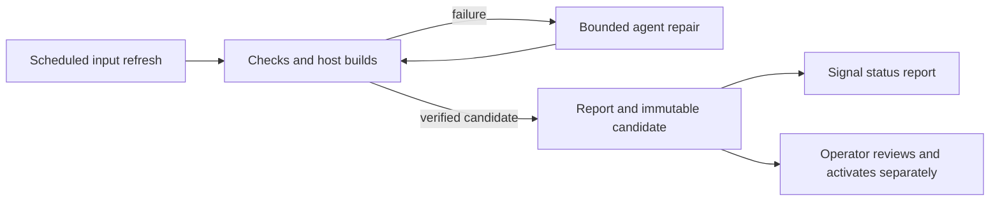

# Agent-assisted NixOS updates

Design recorded on 23 October 2026; implementation task `nixos-6d6`.
On 27 October John chose status-only Signal notifications: phone messages must
not control update preparation, approvals, activation, or other workflows.
The NUC's private Signal transport is active; John verified Note to Self delivery
and an iPhone notification on 23 October. Preparation and reporting are described
below. No activation executor is implemented. The recent migration remains
tracked separately in `nixos-uez`.

## Confirmed policy

- Automatically prepare updates, build, debug failures, and produce reports.
- Require John's approval before activation on both desktop and NUC.
- Deliver status reports through Signal; do not accept commands or approvals.
- Link John's existing Signal account and use Note to Self; no spare number is
  available for a separate bot account.
- Preserve switch inhibitors and request a separate planned reboot when needed.

One central linked device can cover both hosts and future services. Its keys
provide access to the personal account, so keep them separate from update
workspaces and agent credentials. Never run `register` for the existing number;
use the linked-device QR flow.

## Why the built-in update timer is insufficient here

NixOS provides `system.autoUpgrade`, with `switch` and `boot` operations.
The installed nixos-rebuild-ng explicitly warns that `--upgrade` has no effect
for flake-based systems. Refreshing and rebuilding an unchanged lock file does
not advance the pinned package snapshots.

Use a scheduled preparation job that explicitly updates selected flake inputs
in an isolated checkout. Track separately pinned OCI images, Stremio source
versions and hashes, and temporary security fixes too. A timer that only runs
the existing rebuild command would miss those updates.

At design time local main is 25 commits ahead of origin/main. Before enabling
an updater that consumes GitHub, reconcile the published source with the
reviewed local configuration. Candidate reports must identify their exact base
commit. The preparation job must not change John's normal working checkout.
The initial implementation uses reviewed local `main`, so it does not consume
the older `origin/main`; publishing the reviewed history remains separate work.

## Proposed workflow



The repair loop has a finite attempt limit and a time/cost limit; values remain
to be configured. Exhausting a limit produces a failure report and a Beads
handoff. No further repair or activation is implied by an expired job.

Start with systemd scheduling, Nix's own update/build commands, a Codex worker,
and a small reporting component. Existing OpenRig experiments may
provide execution oversight, but a new orchestration framework is not required.
Preparation runs on the desktop, weekly on Sunday at 03:00 local time with up
to 20 minutes of randomized delay. A persistent user timer catches missed runs
when the user manager next runs. Full flake checks belong on the desktop/build host: evaluating the other hosts on the NUC
previously caused it to realize unrelated workstation dependencies.

### Preparation and debugging

1. Create a clean candidate branch/worktree from the recorded base commit.
2. Refresh the selected inputs and report versions, revisions and image digests.
3. Format, evaluate, check, and build the desktop and NUC candidates. Keep source
   and lock file unchanged between the final successful checks and review.
4. On failure, give the unprivileged agent the logs, candidate diff and relevant
   module context. Allow edits only in the candidate workspace, then rerun the
   same checks. The coordinator independently records exit codes and artifacts.
5. Produce a report whether the outcome is ready, failed, inconclusive, or needs
   an operator. Build success alone is not an activation or application test.

Codex supports non-interactive execution, workspace permissions, JSONL events
and schema-constrained final reports. The installed CLI exposes these features.
John selected his existing desktop Codex sign-in. The repair command ignores
personal config/rules, uses the CLI's default model, and has a separate explicit
permission profile. Its commands can edit the candidate and read runtime tools;
they cannot read the original repository, account keys, or report directory,
and have no command network access. Candidate builds/checks use a separate HOME
and do not inherit API/SSH credential environment variables. Each job allows at
most two repairs of ten minutes each within a one-hour preparation deadline.
The local subscription's rate limits still apply; no API key has been configured.

The worker must not weaken TLS, remove tests to obtain a pass, change trust or
privilege policy, or bypass switch inhibitors. Today's D-Bus failure should
produce a boot-and-reboot plan. Today's Beads failure should produce a tested
schema-migration fix and a coordinated client/server activation plan. A changed
candidate always requires a new review.

### Report contents

- Host, base/candidate commit, lock digest and immutable system output path.
- Input/package changes, agent edits, attempts and resource usage.
- Checks actually run, their exit statuses and failures or untested behavior.
- Expected service restarts, schema changes, backup requirements and reboots.
- Proposed privileged actions and the relevant recovery limitations.
- The local report and log location for operator review.

Reports must distinguish certificate rejection from timeout or DNS failure.
Unavailable external test endpoints yield an inconclusive result. Container
tests and application workflow checks remain distinct from host package builds.
Reports sent outside the host must exclude credentials and private log content.

## Privileged activation

Signal is status-only. Review and activation happen separately under John's
direct control; no Signal reply authorizes a command or update. The agent does
not receive a sudo password or general passwordless sudo. Signal credentials
remain outside the candidate workspace.

After activation, perform local service checks and a separate client check of
router connectivity. Connectivity rollback support from an existing tool such
as deploy-rs is worth evaluating. A generation rollback does not undo database
migrations: retain verified PostgreSQL, Dolt and application backups and report
when recovery needs an operator. Candidate Beads binaries must not contact the
live database during preparation; shared schema/client changes need a fleet
plan and a backup before the first new client connection.

An activation failure starts a new diagnostic/repair job. Further privileged
changes require a fresh approval. Reboot remains its own approved operation.

## Signal transport and account choice

Signal automation commonly uses signal-cli, an unofficial client supporting
registration, device linking and a JSON-RPC daemon. Keep its interface local
and its cryptographic state private. Its upstream warns that old clients can
stop working as Signal's server protocol changes; the transport needs update
monitoring and a local/manual fallback when notifications are unavailable.

A dedicated bot would appear as a normal contact, such as "Homelab Updates",
and report for both hosts. Registering a fresh numbered account normally needs
a second number under John's control that can receive SMS or voice verification.
Do not register over John's current personal Signal identity. The bot can be
registered through signal-cli or linked to an existing dedicated account.

The selected Note to Self approach carries reports for multiple hosts. signal-cli supports
`--notify-self` for notification behavior, so it should not be dismissed as
incapable of alerts. A separate account can be reconsidered if a number becomes
available or additional recipients are needed.

### Transport setup on the NUC

`services.signalUpdates` provides signal-cli from the locked unstable input,
an isolated `signal-updates` system user, private state in
`/var/lib/signal-updates`, and a Unix socket in `/run/signal-updates` (both
directories mode 0700). It opens no TCP listener. The daemon can run before
linking. Received message bodies are not printed; attachments, stories, avatars
and stickers are not downloaded. Personal account traffic can still reach this
linked device; keep its state and socket inaccessible to the repair worker.
Java's default trust store is generated from `security.pki.caBundle` so it follows
the host's CA policy rather than retaining Java's separately bundled roots.
Signal's explicit service trust store remains managed by signal-cli.

After building and activating the NUC configuration, run on the NUC:

```sh
sudo signal-updates status
sudo signal-updates link
sudo signal-updates test
```

In Signal on iPhone, open Settings → Linked Devices → Link New Device and scan
the terminal QR code. Choose Don't Transfer History if offered. The device is
named `NUC Update Reports`. Linking refuses an existing local account. The test
sends a fixed inert message only to Note to Self and requests a notification;
confirm both arrival and notification on the phone. It does not send a message
merely by linking or starting the service. A timeout is not proof that linking
or sending failed: check status/Note to Self before retrying.

The transport does not consume approval replies or activate updates.
Its tests cover real-daemon startup without an account, socket response/event
handling, account ambiguity, self-only routing, failed delivery, and the linking
flow. Live linking, text delivery and an iPhone notification have been confirmed.

The `report` command accepts a bounded metadata summary on stdin and always
sends to Note to Self. Its schema excludes message bodies, recipients, raw
logs and agent replies. A sudo rule lets John run exactly
`sudo -n -u signal-updates /run/current-system/sw/bin/signal-updates report`;
this grants send-only reporting as the isolated account, not access to the
socket or an activation command. The coordinator uses John's existing NUC SSH
key; the repair worker cannot read that key.

Reports identify refreshed inputs and explain recognized failures using fixed,
allowlisted descriptions; other failures point to the local logs. Install the
updated NUC transport before updating the desktop coordinator: the new transport
accepts the previous report format, but the previous transport rejects the new
diagnostic fields. Neither installation sends a test message by itself.

To disconnect, remove `NUC Update Reports` from Signal's Linked Devices and
stop/disable the service through NixOS. Revoking the device does not erase its
local state or backups; handle `/var/lib/signal-updates` as account credentials.

The live delivery test was an inert message. Signal replies are not processed
as commands or approvals.

## Running candidate preparation

`scripts/updates/prepare.py`, packaged as `update-prepare`, clones reviewed local
`main` into a separate private directory. It does not pull or modify the normal
checkout. It refreshes the lock, commits the candidate before checking it, checks
changed Nix formatting, runs the flake checks, and builds desktop and NUC with
one local build job and two build cores. Each successful output has a persistent
GC root beside its report. Failure triggers bounded repair and the same checks
again. A changed candidate gets a new commit and lock hash; agent assertions do
not determine whether a check passed.

Reports and numbered command logs live under
`~/.local/state/nixos-updates/<run-id>/`. Each run records base/candidate commit,
lock hash, input revisions/hashes, independent application pins, actual exit
codes, repair count, and built system paths. Keep these directories private.
There is no automatic retention cleanup yet: after review, remove an unwanted
run's GC-root symlinks and candidate when its artifacts are no longer needed.

After activating the NUC reporting permission and desktop configuration:

```sh
systemctl --user status nixos-update-prepare.timer
systemctl --user start --no-block nixos-update-prepare.service
journalctl --user -u nixos-update-prepare.service -f
```

For a manual run without refreshing inputs or using the agent:

```sh
nix --store daemon run --no-write-lock-file .#update-prepare -- \
  --repo "$PWD" --no-refresh --repair-attempts 0 --notify-signal
```

Without `--notify-signal`, the same command only saves the local report. A
notification has a separate 40-second allowance after the preparation deadline;
a failed send preserves the local report and returns a failed job exit status.
Stopping the service cancels its process group and leaves the partial report.
Use `systemctl --user stop nixos-update-prepare.timer` to stop scheduling; stop
the service separately to cancel an active job.

The initial pipeline refreshes flake inputs. Home Assistant/ESPHome image digests
and Stremio source pins are inventoried but not automatically refreshed, and the
runtime TLS/container/service workflow checks are not yet automated. Reports
explicitly require operator review. There is no Signal approval parser or host
executor, so replying to a build report cannot activate a candidate.

Verification includes bounded retry, timeout/child termination, source checkout
isolation, private state/locking, credential environment separation, and safe
notification summaries. A real signed-in Codex run repaired a disposable failing
flake in one attempt; the original checkout and the assertion were preserved,
and the coordinator then independently passed the flake check and built its
system output. Live reporting of an actual host candidate remains a separate
post-activation check.

## Reducing the need for future patches

Fresh inputs reduce the time spent on stale package versions. Temporary fixes
also need a retirement process: record the incident/upstream issue and the test
that justified each workaround, then trial removing it in a candidate. Propose
removal only when the unmodified runtime passes the relevant checks. Version
strings alone are insufficient for certificate data and distribution backports.
The trust-policy denylist can remain explicit while redundant package rewriting
is retired. New runtime variants and known residuals such as `nixos-nzf` need
coverage; the existing list is not a universal vulnerability detector.

Automation can prepare and verify an emergency patch when upstream lags. It
cannot guarantee that every incident will be fixed by updating the inputs.

## Implementation milestones

1. Report-only candidate preparation with bounded repair and persistent results.
   Demonstrate a successful candidate and a recoverable build failure without
   changing a live host or the user's checkout.
2. Verify useful status delivery through the selected personal linked device.
3. Improve independent application pin refresh and runtime regression checks.
4. Keep activation under direct operator control, with backup, recovery, router
   and shared-database coordination checks before switching.

The transport and phone notification are verified. The preparation/reporting
implementation does not complete independent application pin updates or runtime
regression coverage. Signal approval and remote execution are not planned.

## Sources checked

- Installed NixOS auto-upgrade module and nixos-rebuild-ng source: supported
  operations and the flake `--upgrade` warning.
- [Official OpenAI non-interactive Codex documentation](https://learn.chatgpt.com/docs/non-interactive-mode).
- [Official OpenAI permission profiles](https://learn.chatgpt.com/docs/permissions).
- [signal-cli README](https://github.com/AsamK/signal-cli) and
  [notification behavior](https://github.com/AsamK/signal-cli/discussions/1458).
- [Signal registration requirements](https://support.signal.org/hc/en-us/articles/360007318691-Register-a-phone-number).
- [MulmoClaude Signal bridge account guidance](https://github.com/receptron/mulmoclaude/blob/main/packages/bridges/signal/README.md).
- [IronCurtain transport design](https://github.com/provos/ironcurtain/blob/master/TRANSPORT.md),
  which supports dedicated or linked accounts and Signal approval replies;
  this is a reference, not an installed or independently verified dependency.
- [deploy-rs connectivity rollback](https://github.com/serokell/deploy-rs).
