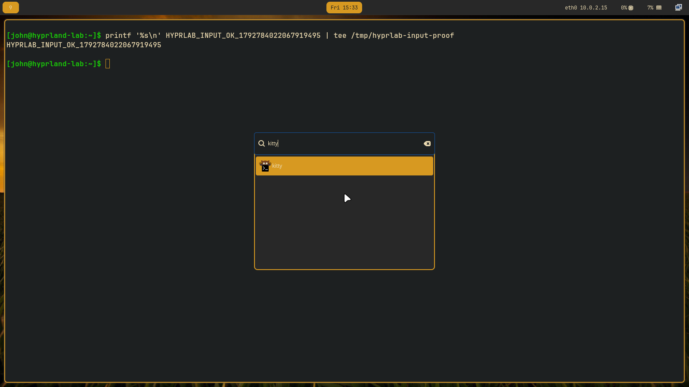
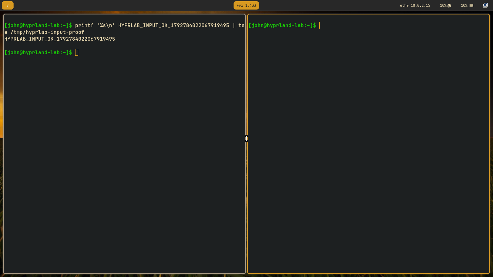

# Hyprland development lab

The `hyprland-lab` NixOS host runs the laptop's Home Manager configuration in
a disposable QEMU/KVM guest, with a real Hyprland session and accelerated
VirtIO graphics. Local agents control it through `hyprlab`, inspect compositor
state and screenshots, and iterate without changing the host desktop session.



## Start and use the lab

From a checkout containing this feature:

```sh
nix run .#hyprland-lab -- start
nix run .#hyprland-lab -- verify
nix run .#hyprland-lab -- shot /tmp/hyprland.png
```

The first start builds a bootable disk; subsequent starts reuse it. By default
the guest renders headlessly on `/dev/dri/renderD128`. The host needs readable
and writable `/dev/kvm` and a working render node. An agent sandbox that hides
these devices must launch the tool outside that sandbox, as the ordinary host
user. No host sudo or host configuration switch is needed.

For faster repeated commands, build the tool once:

```sh
nix --store daemon build --no-write-lock-file .#hyprland-lab --out-link /tmp/hyprlab-cli
/tmp/hyprlab-cli/bin/hyprlab status
/tmp/hyprlab-cli/bin/hyprlab exec --root -- id
/tmp/hyprlab-cli/bin/hyprlab session -- hyprctl clients -j
/tmp/hyprlab-cli/bin/hyprlab key meta_l-q
/tmp/hyprlab-cli/bin/hyprlab click 800 450
/tmp/hyprlab-cli/bin/hyprlab type 'printf "Hello from the VM\n"'
/tmp/hyprlab-cli/bin/hyprlab key ret
/tmp/hyprlab-cli/bin/hyprlab shot /tmp/terminal.png
```

`key` uses QEMU key names: `meta_l-q`, `meta_l-r`, `meta_l-e`, `meta_l-2`,
`ctrl-c`, `esc`, `ret`, and so on. These go to the guest even when the host
desktop would normally intercept the same key combination. `click` takes
screenshot pixel coordinates. `type` uses the guest's virtual keyboard
protocol. `session` provides the graphical session environment for guest
commands. `exec --root` provides root only inside the guest.

`ssh` opens an interactive guest shell. `reboot` waits for a changed
guest boot ID and a working graphical session; `wait` waits for the session.
If Hyprland fails to start, inspect `exec --root -- journalctl -b`,
`qemu.log` and `serial.log`, then repair/redeploy over guest SSH. Screenshot
capture requires a running guest compositor; QEMU's `screendump` reports
`no surface` with this accelerated headless backend.

To view the VM in a local window, stop and restart the same run:

```sh
/tmp/hyprlab-cli/bin/hyprlab stop
/tmp/hyprlab-cli/bin/hyprlab start --window
```

`start --rendernode /dev/dri/renderD129` selects a different host GPU.
For parallel experiments, give each one a different **state directory and
port**, e.g. `hyprlab --state /tmp/my-private-lab start --port 2223`.
State directories must be owned by the caller and mode 0700. The tool locks
each state directory while a command runs, including the complete smoke test.

## Develop and review a change

Edit the shared files used by the laptop and VM:

- `modules/home/hyprland.nix`: bindings, windows, decorations and startup.
- `modules/home/waybar.nix`: bar modules and styling.
- `modules/home/theme.nix`: shared colors and fonts.
- `hosts/laptop/home.nix`: laptop's profile selection and personal settings.
- `hosts/vm/lab.nix`: lab-only access, display and virtual hardware settings.

Build and activate the candidate **in the guest**:

```sh
/tmp/hyprlab-cli/bin/hyprlab --flake . deploy
/tmp/hyprlab-cli/bin/hyprlab verify
/tmp/hyprlab-cli/bin/hyprlab reboot
```

`deploy` builds `nixosConfigurations.hyprland-lab.config.system.build.toplevel`
on the host, copies the closure over SSH, selects that guest generation and
activates it. The guest needs no network access for this workflow. Its complete
writable disk and bootloader let the selected generation survive reboot.
Some startup-only changes need a guest reboot or session restart to take effect.

For a quick disposable preview, use `session -- hyprctl keyword ...`, then
`session -- hyprctl reload` to restore the managed configuration. Keep accepted
changes in Nix and validate them with `deploy`; live keywords are not durable.

The automated `verify` command exercises real compositor key bindings,
terminal text entry, application search/selection, tiling and split direction,
file-manager launch, and a temporary border change followed by restoration.
It also checks guest root, KVM, config errors, Waybar/portal service state,
filesystem shares and blocked host/LAN/Internet connections. It collects PNGs
and `report.json` under the current run's `artifacts/<timestamp>/` directory.
It uses workspace 9 and closes the windows it opened; use a dedicated lab run
with no unsaved personal work.

An agent should use this loop for visual changes:

1. Capture the baseline at a fixed resolution and perform the relevant actions.
2. Apply the candidate, rerun those actions, and open the resulting PNGs with
   its image inspection tool. Assess text readability, clipping, spacing,
   overlap, focus/selection visibility, colors and unexpected error overlays.
3. Compare the actual layout and interaction against the requested change.
   Inspect `hyprctl` state and logs when the image is ambiguous.
4. Fix and repeat, retaining the images and report for each iteration.
5. Reboot and recheck startup-dependent behavior before declaring success.

**A passing smoke report is not a visual review.** The screenshots must actually
be inspected by a vision-capable agent. There is no autonomous agent scheduler
or image-model API embedded in this tool; the working agent supplies that
review loop. Existing agents can do it with shell commands and image viewing,
without a human reviewing each iteration. The smoke checks cover a useful
baseline, not every UI state or aesthetic requirement.



## State, reset and isolation

The default state directory is `~/.local/state/hyprland-lab`:

```text
base -> GC-rooted built VM launcher and disk image
candidate -> most recently built guest system
current -> runs/<timestamp>
runs/<timestamp>/
  base -> GC-rooted base used for this run
  disk.qcow2, efi-vars.fd
  client_key*, host_key*, known_hosts, run.json
  qmp.sock, qemu.pid, qemu.log, serial.log
  artifacts/<timestamp>/*.png, report.json
```

To test a clean boot of updated source, rebuild the base before resetting:

```sh
/tmp/hyprlab-cli/bin/hyprlab --flake . build
/tmp/hyprlab-cli/bin/hyprlab reset
/tmp/hyprlab-cli/bin/hyprlab start
/tmp/hyprlab-cli/bin/hyprlab verify
```

`reset` shuts down the current guest and removes only the `current` pointer.
The next start makes a new writable overlay and fresh keys. Old disks, logs
and screenshots remain available; they are not automatically garbage-collected.
Each run retains its original QEMU launcher. To pick up the QEMU 11.1.2 EGL
shutdown fix, build the base and reset before starting a new run.
`stop` preserves the current disk for later restart. `force-stop` sends QMP
`quit` when a guest will not shut down normally and may lose guest writes.

The lab has no host filesystem shares, physical disk passthrough or forwarded
SSH agent. Fresh client and server lab keys are injected through QEMU firmware
files; the server key is pinned before the first SSH connection. The guest
has passwordless sudo and trusts its `john` account for Nix store imports.
Its disposable console password is `lab`; SSH password and root logins are
disabled. Do not copy personal credentials into it.

QEMU runs as the ordinary host user. Guest root is separated by KVM and the
virtual devices, with VirGL adding a host GPU interface. This is useful
containment for configuration mistakes, not a guarantee against a hypervisor
or graphics-driver exploit. `restrictNetwork` blocks guest-initiated traffic;
only the explicit loopback SSH forward is allowed. Removing that restriction
would allow access to more than just public Internet services.

## Desktop migration path

Keep Plasma as the working desktop until the shared Hyprland profile meets
the desired behavior. The lab already imports the laptop's configuration;
there is no separate lab theme or duplicate desktop design to keep in sync.

After lab iterations are stable, enable the NixOS Hyprland session alongside
Plasma on `desktop`, import the existing Wayland Home Manager profile, and
select Hyprland once from SDDM while preserving Plasma as a fallback. Bring
over the desired theme settings explicitly rather than importing the entire
laptop home configuration into the desktop: it also selects laptop applications.
Keep desktop-specific monitor, GPU and wallpaper choices local to the desktop.

Then test the physical desktop's monitors/scaling, GPU, audio, screen sharing,
lock/unlock, suspend/resume and daily applications. Only after those checks
should Hyprland become the default session. This feature changes no desktop
session selection and performs no physical host switch.

## Validation and sources

Verified on the desktop on 2026-10-23 with Hyprland 0.56.2:

- 16 runtime smoke checks passed, with eight screenshots actually inspected
  across the terminal/launcher/tiling/split/native-app scenarios.
- The host-built guest correction activated offline and survived a reboot.
- A fresh base/run booted without the original config errors and discarded
  a root-owned experimental marker. The previous run and its evidence remain.
- A guest root write to the same absolute path as a host probe left the host
  file's SHA-256 unchanged. No host directory mounts were present.
- Launcher appearance was also inspected at 1920×1080 with 125% scaling;
  the normal 1600×900 configuration was restored afterward.
- Six launcher boundary tests, formatting/lint checks and `nix flake check`
  passed. Physical host sessions were not switched.

The fresh-run runtime report and PNGs are retained locally at
`~/.local/state/hyprland-lab/runs/20261023-154132/artifacts/20261023-154141/`.

The initial live run caught two errors accepted by Nix evaluation: the removed
`dwindle:pseudotile` option and the removed standalone `togglesplit` dispatcher.
The shared configuration now removes the unused option and uses
`layoutmsg, togglesplit`. The fixed configuration was copied into the offline
guest, activated, rebooted and visually inspected. See the
[Hyprland 0.55 announcement](https://hypr.land/news/update55/) and
[hyprctl documentation](https://wiki.hypr.land/configuring/core/advanced-configuration/using-hyprctl/).

The launcher has boundary tests for literal guest command arguments, pinned
SSH verification, private state permissions, reset retention/failure behavior,
and QMP replies interleaved with events. They are included in `nix flake check`.
Runtime evidence records exact guest generation, compositor version, display
details, checks and screenshots. Guest root, offline closure deployment,
reboot persistence and actual image inspection are separate checks.

Hyprland 0.56.2 also shows a temporary warning that `.conf` support will be
removed in 0.57. The current shared configuration uses Home Manager's legacy
Hyprlang format. Plan the Lua migration before upgrading beyond the pinned
version; a clean `configerrors` result does not mean there are no deprecation
notifications. The visual review caught this warning as well.

See [QEMU's VirtIO GPU documentation](https://www.qemu.org/docs/master/system/devices/virtio/virtio-gpu.html)
for accelerated graphics and the
[QMP specification](https://www.qemu.org/docs/master/interop/qmp-spec.html)
for guest control. The earlier [investigation](agent-vm.md) contains the
architecture comparison and limitations. VM checks do not validate physical
laptop touchpad, battery, backlight, suspend or GPU behavior, nor do portal
service-state checks establish that screen sharing works in every application.
